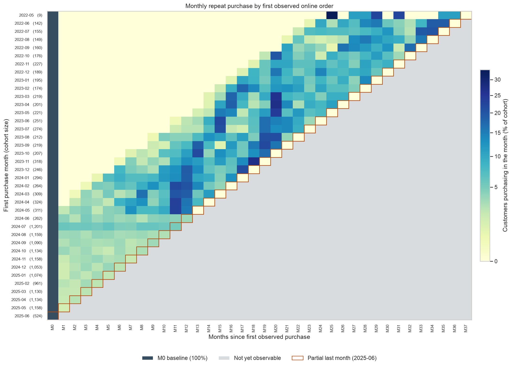

# 첫 구매월별 재구매율

이 분석은 고객별로 데이터에 기록된 **첫 온라인 구매일**을 찾아, 그 날짜가 속한 달을 **첫 구매월**로 정해 고객을 묶는다. 가입일은 제공되지 않아 **가입월 기준 코호트 분석과 구분**한다. 관측 시작일인 2022년 5월 30일 이전이나 다른 판매 채널에서 구매한 이력이 있을 수 있다.

## 읽는 방법

- **행**은 첫 관측 구매월이 같은 고객 집단이다. 고객은 한 집단에만 속하며 전체 18,484명이 포함된다.
- **M0**는 고객이 처음 구매한 달이다. 집단 규모를 정의하는 기준이므로 구매 비율이 항상 100%다. 같은 달 두 번 산 비율을 의미하지 않는다.
- **M1 이후**의 값은 그 월차에 한 번 이상 구매한 고유 고객 수를 해당 집단의 최초 인원수로 나눈 값이다. 한 달에 여러 번 주문해도 한 명으로 세며, 한 달 쉬었다가 다시 구매한 고객도 구매한 월차에 포함한다. 누적 재구매율과는 다른 지표다.
- 관측한 달에 아무도 돌아오지 않았으면 **0%**, 데이터 종료일을 넘는 달은 **미관측**이다. 2022년 5월은 30일부터, 2025년 6월은 29일까지의 부분월이다. 특히 2025년 6월을 대상으로 한 값은 한 달 전체의 실적보다 낮을 수 있다.

## 결과 예시

2024년 6월에 처음 구매한 262명 중 7월에 다시 구매한 고객은 11명(**M1 4.20%**), 8월에 구매한 고객은 7명(**M2 2.67%**)이다. 각 월의 구매자에는 같은 사람이 포함될 수 있으므로 두 비율을 합치면 안 된다.

부분월인 2025년 6월까지 포함하면 M1 구매자는 **346명 / 17,960명(1.93%)**이다. 다음 달을 온전히 관측할 수 있었던 집단에서는 M1 구매자는 **329명 / 16,802명(1.96%)**이다. 2025년 5월 집단은 M1이 부분월이고, 6월 집단은 M1이 아직 관측되지 않아 이 요약에서 제외했다. 이는 달별 비율의 단순 평균이 아니라 고객 수를 반영한 합산 비율이다. 첫 주문 다음 달을 넘겨 돌아오는 고객도 있으므로 장기 재구매 여부는 뒤쪽 월차까지 함께 살펴본다.

[실행 결과와 계산 코드](../notebooks/analysis_report.ipynb)
